# OpenRouter Video for ComfyUI

ARENAS®lab / CREATIVE TOOLS · 001 · Public Beta 1

**One node. Many models. Your workflow.**

An adaptive video system for ComfyUI, powered by OpenRouter. Generate, edit and extend video with supported models through one adaptive interface — without leaving your graph.

| Video models | Model–method pairs | Inference methods |
| :---: | :---: | :---: |
| **28** | **110** | **12** |

[Get Public Beta 1](https://github.com/arenas-lab/ComfyUI-OpenRouter-Video/releases/tag/public-beta-1) · [Installation](#installation) · [Secure connection](#your-account-your-budget-your-control) · [How it works](#different-models-one-interface) · [Quick start](#quick-start) · [Models & methods](#models--methods) · [Security](#trust-and-transparency)

Open source · [MIT License](LICENSE) · Bring your own OpenRouter account

*Public Beta 1 catalogue snapshot: 26–28 November 2026. Availability and capabilities vary by model and may change. Supported pairs are not a count of individually completed live generations.*

## Different models. One interface.

Switch between supported models and inference methods. The node adapts its inputs, parameters and geometry to the selected capabilities.

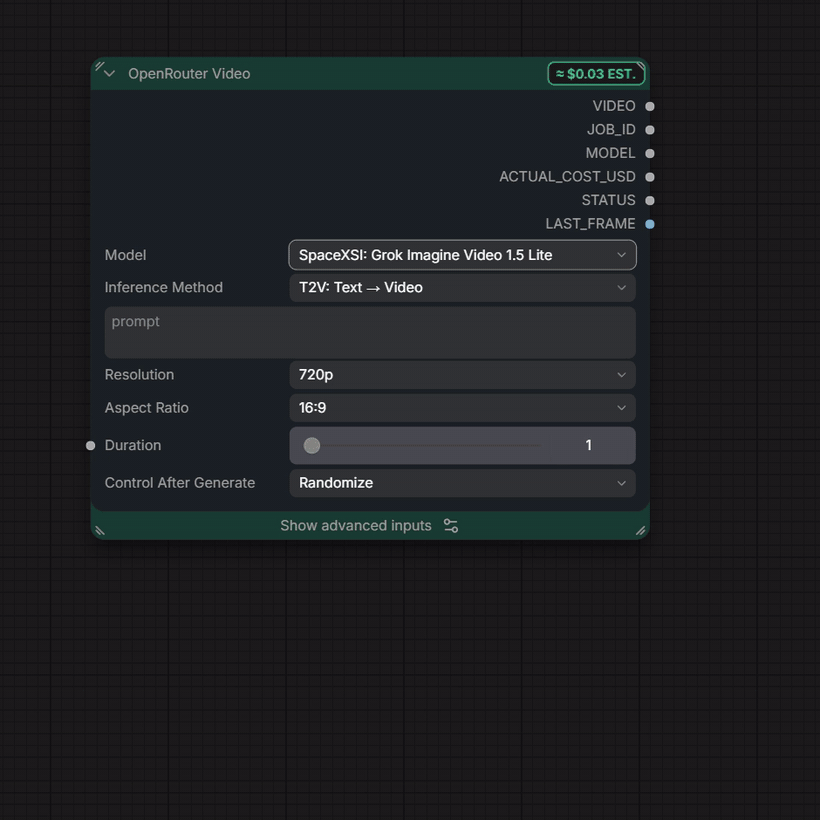

*Real ComfyUI screen recording, cropped to focus on the node.*

## Your account. Your budget. Your control.

Connect directly with your OpenRouter account using the [official OAuth PKCE flow](https://openrouter.ai/docs/guides/overview/auth/oauth). No API key to copy into your node.

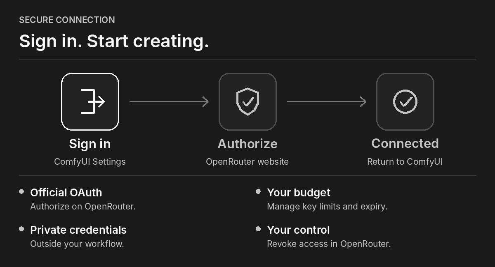

*Illustrated connection flow. See the real interface below.*

**Settings → OpenRouter Video → Connect OpenRouter → Sign in with OpenRouter**

Authorize in your browser, then return to ComfyUI. Manage your key limits, expiration and revocation in your [OpenRouter account](https://openrouter.ai/keys), where available. OpenRouter bills inference to your own balance.

<details>
<summary>See the real connection interface or use an existing API key</summary>

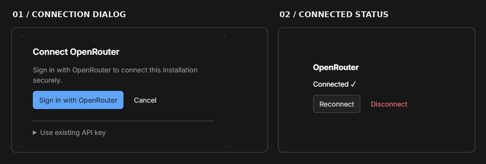

*Two independent native interface captures, not a continuous OAuth recording. Authorization takes place on OpenRouter's website.*

Already have a key? Choose **Use existing API key** in the connection dialog. Managed or headless installations can use `OPENROUTER_API_KEY`.

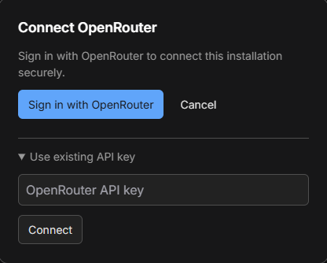

</details>

[Credential storage, privacy and revocation](#trust-and-transparency) · [Security policy](SECURITY.md)

<!-- TRUST ASSET GATE: replace or supplement the illustrated flow with authorized real provider consent and account-management captures. Do not present the illustration as live evidence. Public Beta 1 does not set provider-side caps or expiration. -->

## Keep your connections.


Connect supported image, video and audio references. Grouped Autogrow exposes additional inputs as needed. Incompatible connections are parked rather than discarded and can be restored when compatible again.

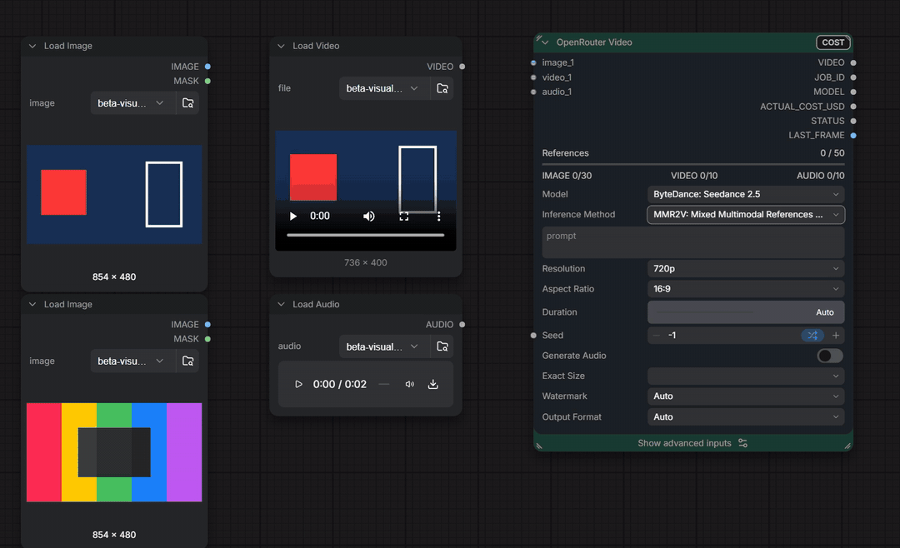

*Real screen recording, cropped and accelerated. Reference types, combinations and limits depend on the selected model and method.*

Native VIDEO and AUDIO references require your own private S3-compatible staging storage. T2V and native IMAGE inputs do not require S3. [Media setup and cleanup](docs/native-media-bridge.md).

## Creative freedom. Financial clarity.

Adaptive Cost Intelligence (ACI) brings available pricing information into the node before generation, with the assumptions and limitations behind each figure. After completion, the node can report the actual cost supplied by OpenRouter.

| Calculated estimate · EST | Known component / reference · REF |
| --- | --- |
| 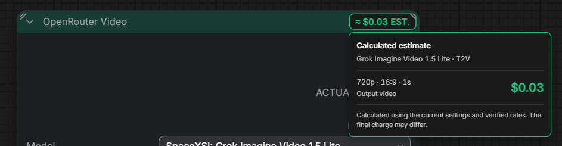 | 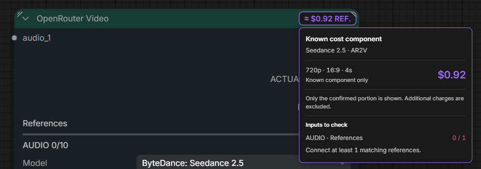 |
| **Conditional scenarios · MODEL** | **No supported total · COST** |
| 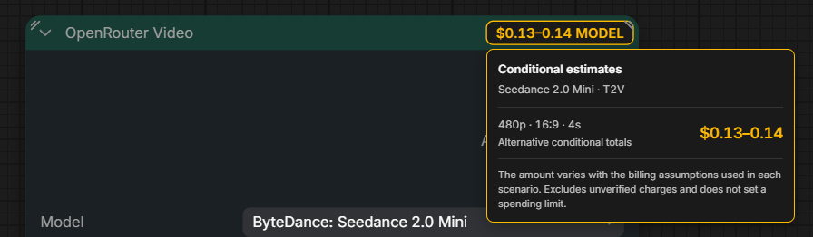 | 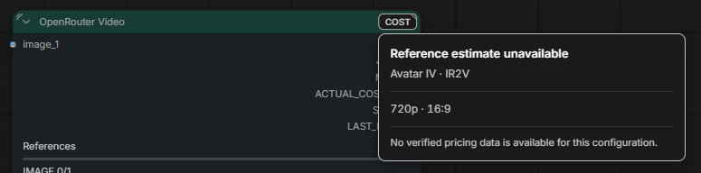 |

EST, REF and MODEL are not guaranteed charges or spending caps. COST can expose available unit rates or indicate missing pricing data. ACTUAL uses provider-reported cost when available; missing actual cost is not zero. Example prices are dated and configuration-specific.

<!-- ACTUAL ASSET GATE: add a rights-cleared, sanitized actual-cost capture, explicitly distinguished from replay and EST. -->

## Built for ComfyUI.

Classic and Nodes 2.0 share the same adaptive semantics. Native VIDEO connects directly to compatible downstream nodes; LAST_FRAME is available as an IMAGE output when extraction succeeds. Job ID, model, status and actual cost (when provided) are exposed alongside media.

| Classic | Nodes 2.0 |
| :---: | :---: |
| 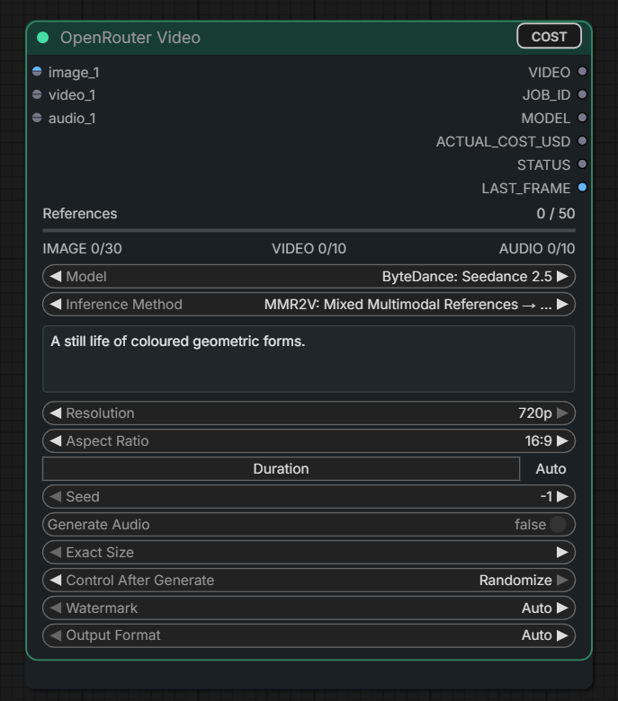 | 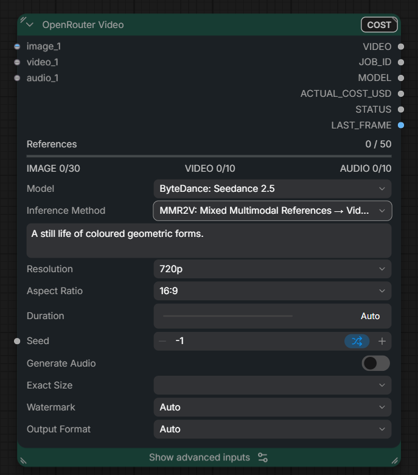 |

## Resume. Don't regenerate.


OpenRouter Video Resume observes and downloads an existing job by ID without submitting a new paid generation. Each intentional Generate operation attempts at most one paid submit. An ambiguous submission, poll interruption or download failure never triggers an automatic paid resubmit. Recovery requires a known job ID and upstream availability. If the submission outcome is unknown and no Job ID is available, do not blindly retry.

## Models & methods

The Public Beta 1 snapshot covers model families including Google Gemini Omni and Veo, ByteDance Seedance, Alibaba Wan, xAI Grok Imagine, MiniMax, Runway and others.

| Method | Models in snapshot |
| --- | ---: |
| Text to Video (T2V) | 22 |
| First Frame to Video (I2V) | 24 |
| First + Last Frame (FLF2V) | 16 |
| Image Reference (IR2V) | 12 |
| Multiple Image References (MI2V) | 10 |
| Video Reference (VR2V) | 8 |
| Audio Reference (AR2V) | 2 |
| Mixed Multimodal References (MMR2V) | 6 |
| Video Editing (V2V_EDIT) | 5 |
| Video Extension (V2V_EXTEND) | 3 |
| Video Upscaling (V2V_UPSCALE) | 1 |
| Avatar Audio (AVATAR_AUDIO) | 1 |
| **Total model–method pairs** | **110** |

These counts describe the dated supported model–method catalogue, not paid live-test coverage. Not all models support all methods. The adaptive controls expose the relevant available configurations.

## Installation

Public Beta 1 is available through [GitHub Releases](https://github.com/arenas-lab/ComfyUI-OpenRouter-Video/releases/tag/public-beta-1). Registry and Manager installation are not yet verified.

Requires **Python 3.10+** and a compatible ComfyUI host with the numbered V3 API `comfy_api.v0_0_2`, native media and dynamic inputs. The native Windows test host used ComfyUI 0.34.3; hosted CI covered Windows and Linux with Python 3.10 and 3.13. These are verification anchors, not a guarantee for every host or platform.

### Standard installation (Git)

Stop ComfyUI. From its root directory, using the Python interpreter that actually runs your ComfyUI installation:

```sh
git clone --branch public-beta-1 --single-branch https://github.com/arenas-lab/ComfyUI-OpenRouter-Video.git custom_nodes/ComfyUI-OpenRouter-Video
python -m pip install ./custom_nodes/ComfyUI-OpenRouter-Video
python -m pip check
```

If using a virtual environment, activate ComfyUI's own environment before running these commands.

### Windows Portable (PowerShell)

Stop ComfyUI. Open PowerShell from the portable root (the folder containing `ComfyUI` and `python_embeded`):

```powershell
git clone --branch public-beta-1 --single-branch https://github.com/arenas-lab/ComfyUI-OpenRouter-Video.git .\ComfyUI\custom_nodes\ComfyUI-OpenRouter-Video
& .\python_embeded\python.exe -m pip install .\ComfyUI\custom_nodes\ComfyUI-OpenRouter-Video
& .\python_embeded\python.exe -m pip check
```

Use the actual interpreter path if your installation differs. A separate clean Windows Portable installation has not yet been confirmed by the available evidence. The commands above are for a new installation; do not create a duplicate custom-node checkout. If `pip check` reports a conflict, resolve it before proceeding.

<details>
<summary>Manual source archive installation (without Git)</summary>

Download `openrouter_video-0.1.0rc2.tar.gz` from [Public Beta 1](https://github.com/arenas-lab/ComfyUI-OpenRouter-Video/releases/tag/public-beta-1). Verify the download against the attached `SHA256SUMS.txt` before extraction. Stop ComfyUI and unpack the distribution into `ComfyUI/custom_nodes/ComfyUI-OpenRouter-Video`, ensuring the package root contains the custom-node entrypoint, `web` directory and `pyproject.toml`. From the ComfyUI root run:

```sh
python -m pip install ./custom_nodes/ComfyUI-OpenRouter-Video
python -m pip check
```

For Windows Portable use its bundled interpreter and the paths shown above. The wheel alone does not install the full custom-node UI.

</details>

## Quick start

**Install → Connect → Generate**

1. Restart ComfyUI and open **Settings → OpenRouter Video → Connect OpenRouter**.
2. Choose **Sign in with OpenRouter** or **Use existing API key**. See [Secure connection](#your-account-your-budget-your-control).
3. Import the starter workflow below, or add **OpenRouter Video** and connect its VIDEO output to **Save Video**.
4. Select an available model and **T2V**, enter a prompt and review the available cost information. Queue only when ready to incur the provider charge.
5. Save your result. Use **OpenRouter Video Resume** for an interrupted known job.

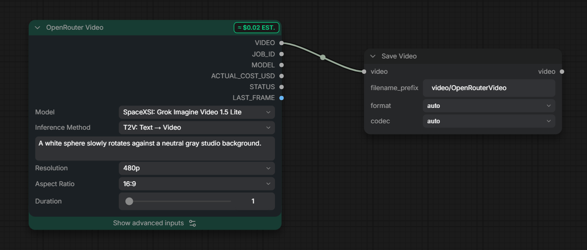

[Open the minimal T2V workflow (JSON)](example_workflows/minimal-t2v-save-video.json) (on GitHub, use Download raw file)

The example contains two nodes and one native VIDEO connection. Loading the workflow or choosing a model does not generate a video. T2V requires no private staging storage. Review the model and parameters before queuing.

*Native pre-submit starter workflow. The cost shown is an estimate, not a completed generation or current quote.*

## Documentation & support

[Release notes and assets](https://github.com/arenas-lab/ComfyUI-OpenRouter-Video/releases/tag/public-beta-1) · [Native media guide](docs/native-media-bridge.md) · [Security](SECURITY.md) · [Changelog](CHANGELOG.md) · [Issues](https://github.com/arenas-lab/ComfyUI-OpenRouter-Video/issues) · [License](LICENSE)


### Trust and transparency

Your OpenRouter account, your API key, your balance. The project is MIT-licensed and has no project-owned telemetry service or mandatory project subscription. Provider inference is billed separately by OpenRouter.

<details>
<summary>API keys, credential storage & privacy</summary>

Interactive credentials stay outside the graph and use the OS credential vault when available, with an indicated session-only fallback. Windows OAuth persistence was verified; other platforms and browser callback behavior may vary. The OS account is the trust boundary: the vault does not isolate credentials from malicious code running as the same user.

OpenRouter provides key limits, reset, expiration and revocation where available; Public Beta 1 does not set these controls itself. Local Disconnect removes the interactive credential, while remote revocation is separate. An environment credential takes precedence and is not removed by local Disconnect.

The plugin does not serialize its credentials into workflow JSON. OpenRouter, upstream providers and configured storage process data required for requests. The MIT license covers project code, not provider inference or third-party media. This is an independent integration, not an official partnership or independent security certification.

</details>

See the [security policy](SECURITY.md) and [release notes](https://github.com/arenas-lab/ComfyUI-OpenRouter-Video/releases/tag/public-beta-1) for known browser callback and host limitations. Provider availability, pricing and capabilities may change; exact output geometry is not guaranteed.

<details>
<summary>Update, rollback and uninstall</summary>

Stop ComfyUI before changing the installation. Inspect local modifications, preserve the ComfyUI user directory (including SQLite recovery data), and check out the intended reviewed revision. Reinstall with the same ComfyUI interpreter, run `pip check` and restart. For a clean tracked branch, use `git pull --ff-only`; do not force-reset user changes.

To disconnect, remove the interactive credential in Settings. To revoke the key remotely, manage it in OpenRouter. Environment credentials must be removed separately. To uninstall, stop ComfyUI, remove the custom-node directory and, if no other installation relies on it, uninstall its Python Core with `python -m pip uninstall openrouter-video` using the ComfyUI interpreter. Preserve recovery data unless you intentionally choose to delete it. Do not remove shared dependencies indiscriminately.

</details>

---

**ARENAS®lab**  
CREATIVE TOOLS

Creative freedom. Engineering precision.
