# Duration Slider — Product Owner Review

RESULT: READY_FOR_PRODUCT_OWNER_VISUAL_REVIEW

Baseline: immutable adaptive-generation-controls-v1, canonical merge of PR #29.
PRE_IMPLEMENTATION_HEAD: 8ec71ba94575f8b02105a0cd0e5feba7d7083b87
POST_IMPLEMENTATION_HEAD (verified production source): 9dc7e43c06619ea9102edbb66792e55f8247221c
Branch: feature/adaptive-duration-slider. Evidence-only commit follows; production source digest remains bound to this verified head.

Duration dropdown is replaced by a horizontal discrete slider in the original named/positional persistence slot. AUTO is a separate model-default button. Equal index spacing guarantees allowed values; seconds remain the product and serialized value. No provider/model branches or new runtime dependencies.

| Example | Model / Method | Domain / allowed values | Selected | Serialized |
|---|---|---|---|---|
| Fresh / sparse | Google Veo 3.1 / T2V | DISCRETE [4,6,8] | AUTO then 4,6,8 | 0 (omitted), then 4,6,8 |
| Two values | Alibaba Wan 2.6 / T2V | DISCRETE [5,10] | 5 then 10 | 5 then 10 |
| Dense | ByteDance Seedance 2.5 / T2V | DISCRETE integers 4..30 (27 values) | 10 then 30 | 10 then 30 |
| Method switch | Seedance 2.5 / I2V | Same confirmed discrete list 4..30 | 30 then AUTO | 30 then 0 (omitted) |
| Incompatible | Veo -> Wan / T2V | [4,6,8] -> [5,10] | 8 preserved with Generate blocked | 8 preserved; upstream submit unavailable |
| Save / reopen | Wan 2.6 / T2V | DISCRETE [5,10] | 10 restored after close/reopen and new page load | saved-workflow.json contains duration: 10; UI index is 1 |

## Evidence and verification

- DURATION_DOMAIN_CLASSIFIER: PASS
- DISCRETE_SLIDER / SPARSE_DISCRETE_DOMAIN / DENSE_DISCRETE_DOMAIN: PASS
- STEPPED_RANGE_SUPPORT: PASS (explicit structured UI fixture)
- CONTINUOUS_RANGE_ARCHITECTURE: PASS (explicit structured UI fixture only)
- CURRENT_MODELS_PROMOTED_TO_CONTINUOUS: 0
- AUTO_DEFAULT / MODEL_ADAPTATION / METHOD_ADAPTATION / CONFIG_REPROJECTION: PASS
- COUPLED_READY: PASS (existing relation projection + singleton-domain pointer test)
- OPTION_SET_CHANGED: NO
- WIRE_SEMANTICS_CHANGED: NO
- CAPABILITY_EVIDENCE_CHANGED: NO
- SAVE_RELOAD: PASS
- PYTHON_TESTS: 379 passed, 3 skipped (unmaterialized third-party media fixtures)
- FRONTEND_TESTS: 37 passed
- RUFF: PASS (check + format)
- MYPY: PASS (96 source files)
- BUILD: PASS (wheel + sdist)
- BASELINE_REGRESSION: PASS
- UNAUTHORIZED_SEMANTIC_DELTA: 0
- REAL_8189: PASS / RUNNING_HEALTHY / 30 models
- OPENROUTER_PAID_POST_COUNT: 0 for this task; Run/Generate never invoked

Semantic export and test rerun used a fresh acceptance lease for this newly created isolated worktree. Checks before/after test commands passed; lease was released and its receipt retained. No Product Owner acceptance record is created by these checks. Browser screenshots are real canonical DEV observations; they are not Owner visual acceptance.

Existing CI still uses the accepted parent cumulative delta for its historical native-media shield. The narrower slider-only delta is independently compared against canonical 8ec71ba: verification/semantic-diff.json reports PASS and no unauthorized changes. Accepted snapshots are untouched. Unrelated frontend functions and normalized live Python/evidence source match baseline. Only Duration presentation helpers and original Duration widget creation/configuration changed; CI includes the new focused frontend test.

Current domains are finite integer lists. True fractional upstream support is not activated: the future continuous fixture proves UI classification/mapping only. The existing ontology/backend must understand an approved precision contract before such a capability can reach this widget. This preserves the requested future architecture boundary.

Native DOM INT callback initially caused setter recursion during browser testing; fixed by retaining semantic slider values without the old INT coercion callback, covered by a DOM setter regression test. AUTO-to-minimum pointer selection is also covered, including singleton domains.

## Screenshots

### 00-before-dropdown

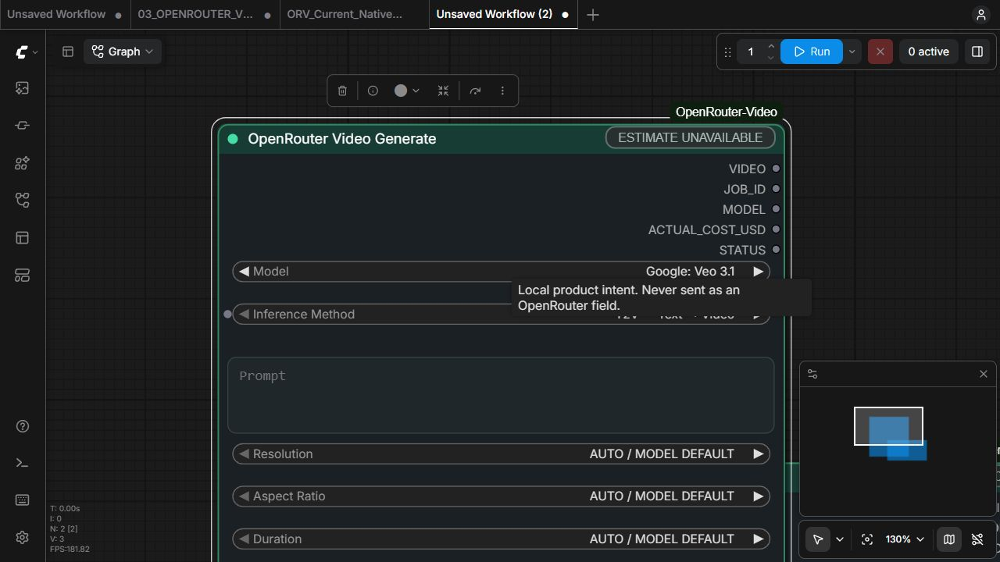

### 01-fresh-auto

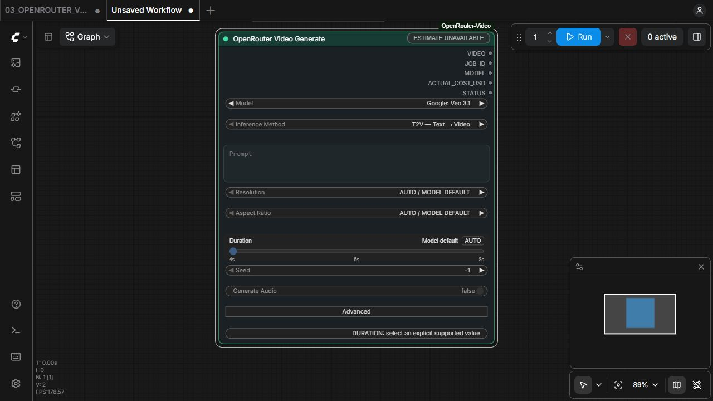

### 02-two-value-discrete

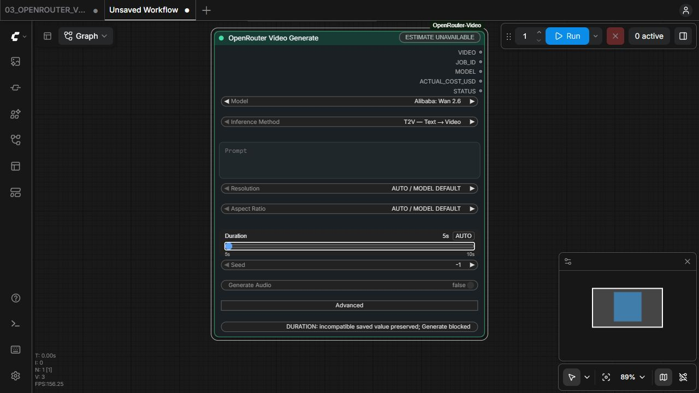

### 03-sparse-discrete

### 04-dense-discrete

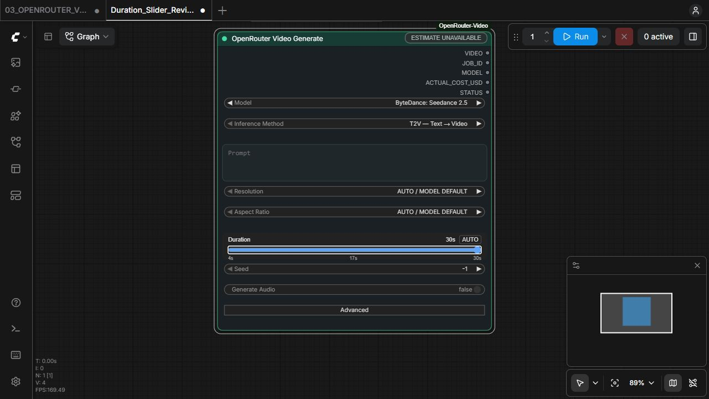

### 05-minimum

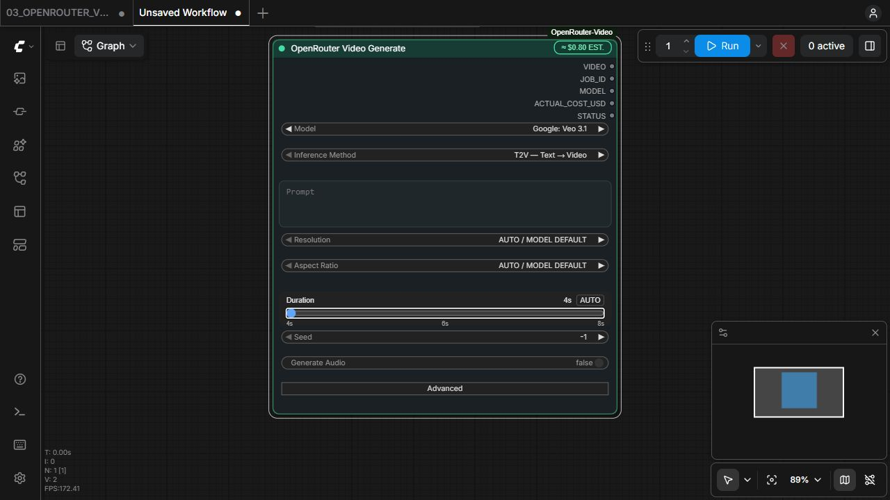

### 06-middle

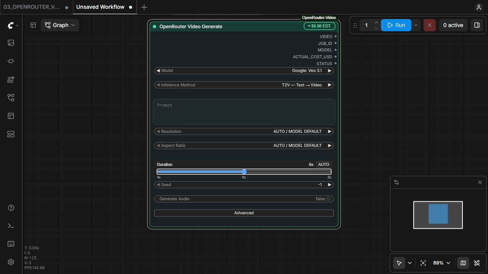

### 07-maximum

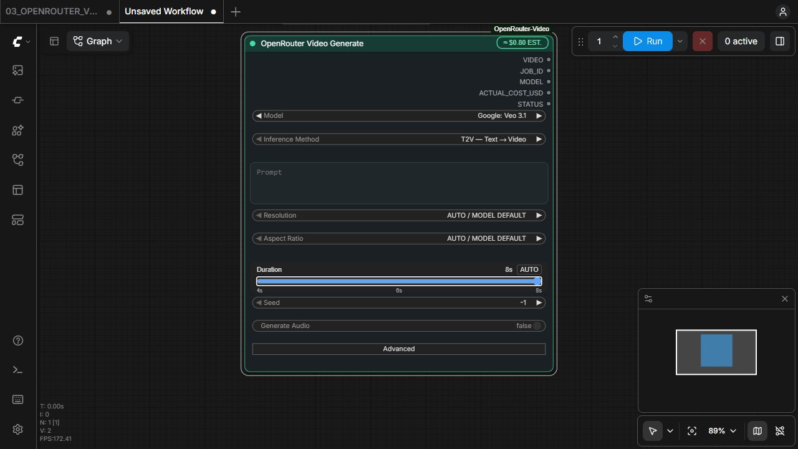

### 08-model-switch

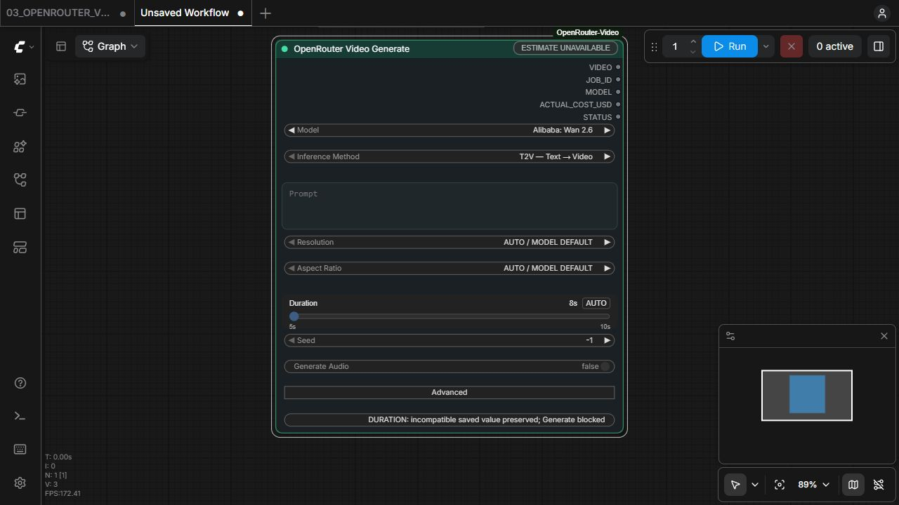

### 09-method-switch

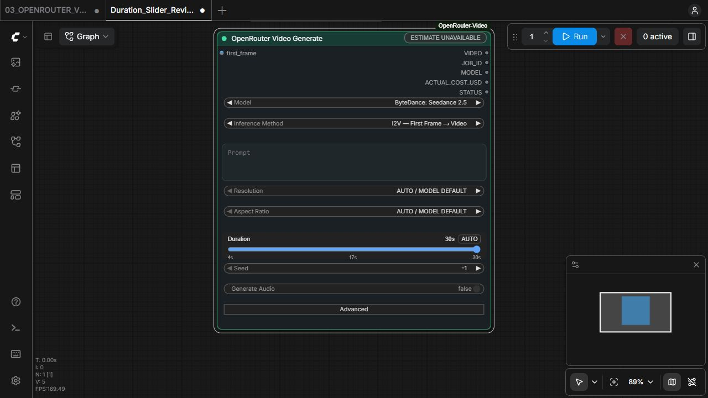

### 10-save

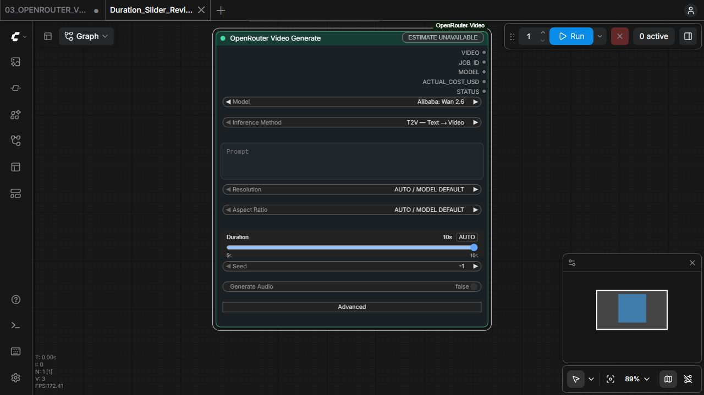

### 11-reload

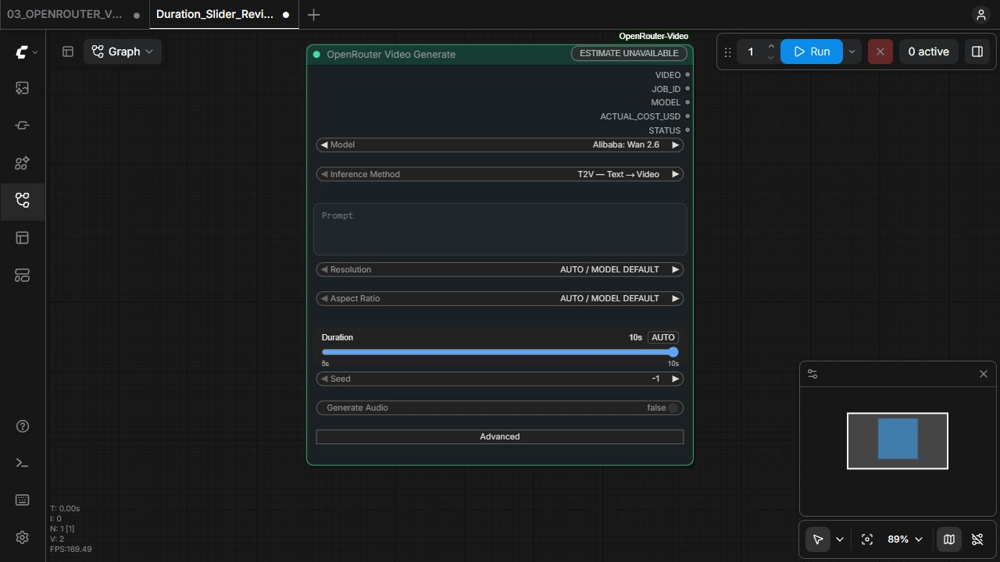

### 12-auto-default

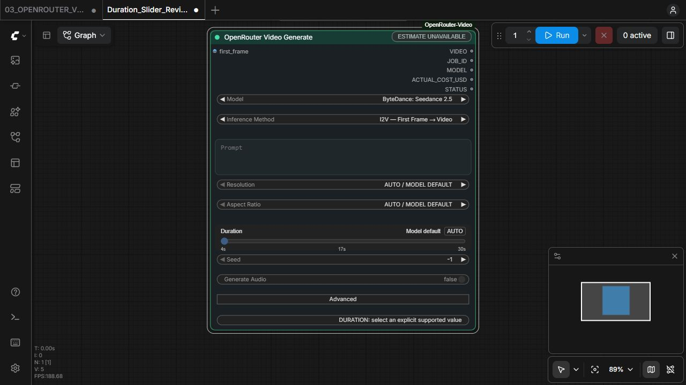

### 13-incompatible

### 14-product-owner-preview

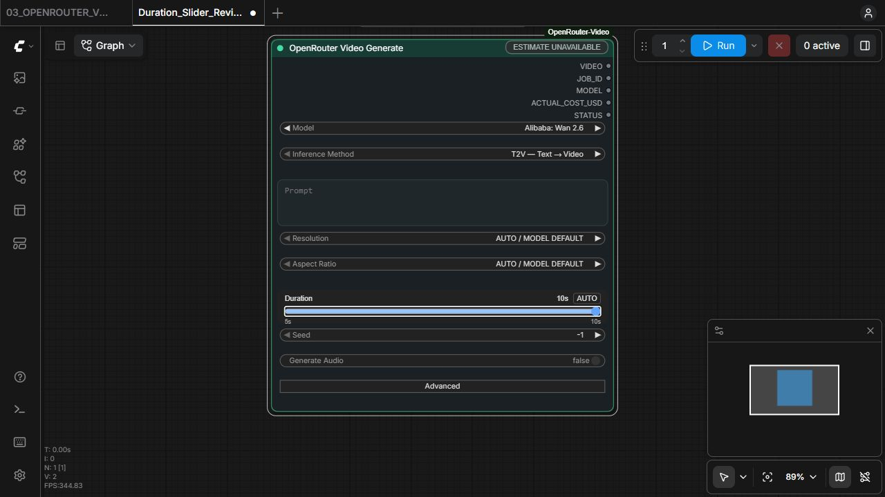

### 15-auto-to-minimum-click

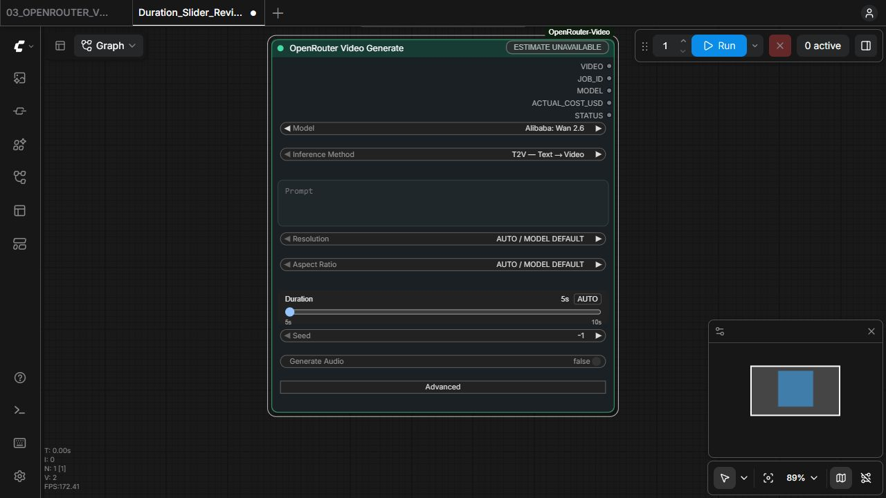

## Review boundary

Merge, tag, release, parent checkpoint mutation: none. The new frontend remains loaded in canonical DEV 8189 for visual review; the original frontend backup is runtime-before.js. Protected delivery waits for explicit Product Owner acceptance of the verified source and artifacts.
