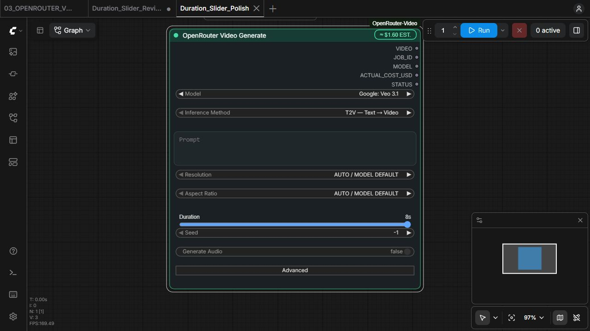

# Duration slider — visual polish review

RESULT: READY_FOR_PRODUCT_OWNER_VISUAL_REVIEW

PRE_ITERATION_HEAD: 574ed24669e0662976569c87329ec7a0c01b7a88

POST_ITERATION_HEAD (verified implementation): 4aee8466df010259c9a56af054db0496d5b02841

BRANCH: feature/adaptive-duration-slider. Subsequent evidence-only commit contains this report and verification artifacts; its exact SHA is reported in the delivery message. No production changes follow the verified implementation head.

## Change and review target

Duration now shows only its name, current seconds, track and thumb. The AUTO button, permanent ticks/min/max footer and enclosing background are removed. Default appears only for semantic zero. The control measures 42 graph units instead of 70, a reduction of 28. Reset is the native node context-menu action **Reset Duration to model default**. It uses the existing value selection path and preserves other menu contributions.

The Default-only instructional STATE hint is removed. Unverified/incompatible saved-value disclosures remain. All domain/classifier, adaptation, coupling, persistence and request conversion functions retain their prior behavior. Every Python production file is unchanged.

## Requested result fields

| Field | Result |
|---|---|
| DURATION_VISUAL_DENSITY | PASS — measured 70 → 42; visual acceptance remains Owner's decision |
| AUTO_BADGE_REMOVED | PASS |
| DEFAULT_SEMANTICS_PRESERVED | PASS — zero persists; upstream omission verified by unchanged wire tests |
| MIN_MAX_LABELS_REMOVED | PASS |
| CURRENT_VALUE_VISIBLE | PASS — compact Ns, or Default only at zero |
| DISCRETE_SNAP | PASS |
| MODEL_ADAPTATION | PASS |
| METHOD_ADAPTATION | PASS |
| OPTION_SET_CHANGED | NO |
| WIRE_SEMANTICS_CHANGED | NO |
| CAPABILITY_EVIDENCE_CHANGED | NO |
| SAVE_RELOAD | PASS — actual DEV 8 → 8 and zero → zero |
| PYTHON_TESTS | 379 passed, 3 skipped |
| FRONTEND_TESTS | 44 passed, 0 failed; all prior tests retained |
| BASELINE_REGRESSION | PASS |
| UNAUTHORIZED_SEMANTIC_DELTA | 0 |
| REAL_8189_VISUAL | PASS — observed implementation; Owner acceptance pending |
| OPENROUTER_PAID_POST_COUNT | 0 — no Generate/Run/Resume submission invoked |

Python skips are existing unmaterialized third-party Golden Pack media; no download or paid runtime validation was performed. Ruff check/format and mypy passed. Full Python regression used the accepted adaptive-generation-controls delta for the historical baseline shield. This iteration's independent semantic export compares 574ed24 against 4aee846 with its own visual-polish delta.

## Evidence and limits

The exporter reports no authorized semantic changes, no unauthorized changes and no unknown dynamic surfaces. Presentation-only edits leave its protected semantic projection unchanged. The additional frontend negative-space test compares all other top-level functions with 574ed24. [Semantic diff](verification/semantic-diff.json), [baseline](verification/baseline-contract.json), [current](verification/current-contract.json), [lease receipt](verification/lease-receipt.json), [Python log](verification/python-tests.txt), [frontend log](verification/frontend-tests.txt).

Explicit workflow [JSON](explicit-workflow.json) stores duration=8, not display index=2. Default workflow [JSON](default-workflow.json) stores duration=0. All other named values match between these captures. Both were saved and reloaded through the real ComfyUI interface. Wire omission is deterministic test proof, not a paid upstream submission.

Actual DEV evidence: authenticated catalogue FRESH, 30 models, UI contract 4, RUNNING_HEALTHY, PID 20516. Source fingerprint a28e6c6672627f488b149a0775362abc94c978106d06840862d79c1a7239179e. Deployed frontend SHA256 654f3d1976727cbe948ad8f410bb199647170408dafe2ea53c0685d6fdd1329f matches the worktree byte-for-byte. The canonical DEV supervisor restarted only 8189. Port 8188 and C:\ ComfyUI installations were not used.

The current live dense domain is Seedance 2.5 **[4..30]**, not [1..30]. The requested dense [1..30] example is covered by a frontend fixture; it is not injected into the live catalogue or misrepresented as a model capability.

| Screenshot | Observed state |
|---|---|
| [01](01-native-comparison.png) | Existing Owner workflow with comparable ByteDance node, observed without modifying it |
| [02](02-fresh-default.png) | Fresh node, Wan 2.6, Default |
| [03](03-two-min.png), [04](04-two-max.png) | Wan 2.6 [5,10], 5s and 10s |
| [05](05-model-switch-incompatible.png) | Switch to Veo 3.1 preserves incompatible 10s and Generate-blocked disclosure |
| [06](06-sparse-min.png), [07](07-sparse-middle.png), [08](08-sparse-max.png) | Veo 3.1 [4,6,8], Home/Right/End |
| [09](09-explicit-reloaded.png) | Saved and reloaded explicit 8s |
| [10](10-native-reset-menu.png), [11](11-default-reloaded.png) | Native reset action and saved/reloaded Default |
| [12](12-dense-min.png), [13](13-dense-max.png), [14](14-dense-middle-drag.png) | Seedance 2.5 [4..30], 4s/30s and pointer drag to 17s |
| [15](15-method-switch.png) | Method T2V → FLF2V, 17s preserved, reference sockets reprojected |

Model and Inference Method remain visible in the review captures. A separate Duration_Slider_Polish workflow was created; the existing Owner workflow was not saved or overwritten.

## Builder result contract

REQUEST_STATUS: DONE — requested bounded polish, tests, commit and review package complete.

PRODUCT_STATE: READY_FOR_PRODUCT_OWNER_VISUAL_REVIEW; technical verification PASS; visual acceptance pending.

ACCEPTANCE_STATE: CONTRACT_DELTA_REQUIRED — declared delta supplied; exact-head Owner acceptance not yet granted. No canonical accepted checkpoint created for this iteration.

DELIVERY_STATE: local feature branch committed; no push, PR, merge, tag or release.

CANONICAL_STATE: unchanged; feature has not been merged into main.

BASELINE_USED: immediate iteration 574ed24; accepted parent adaptive-generation-controls-v1 at 8ec71ba94575f8b02105a0cd0e5feba7d7083b87. Iteration baseline is not canonical visual acceptance.

BASELINE_CHECKPOINT: duration-slider-functional-review-574ed24 at 574ed24669e0662976569c87329ec7a0c01b7a88, review checkpoint only.

SEMANTIC_DIFF: PASS.

UNAUTHORIZED_DELTA: NONE.

UNKNOWN_DYNAMIC_SURFACES: NONE in this bounded comparison using unchanged catalogue evidence.

CONTRACT_DRIFT: NONE detected for this bounded local iteration; no new external contract research performed.

UPSTREAM_EXPANSION: NONE.

VERIFICATION: 379 Python / 44 frontend pass, 3 known media skips; real DEV browser, reset, pointer/keyboard navigation, model/method adaptation, save/reload; released acceptance lease.

SIDE_EFFECTS: filesystem writes to isolated worktree and its review evidence; only frontend JS deployed to the existing DEV source checkout; canonical DEV 8189 supervisor restart; new local review workflow saved; local commits. Fetch: NONE. Push: NONE. PR: NONE. Merge: NONE. Paid POST: 0. Production-key access: NONE.

OPEN_GATES: Product Owner visual acceptance; all protected delivery gates remain separate.

NEXT_EXACT_ACTION: Product Owner reviews explicit/default captures and the open Duration_Slider_Polish DEV workflow.

## Короткий лог для трекера

OpenRouter Video / Duration visual polish: убраны AUTO-кнопка, ticks и min/max footer; оставлены имя, выбранные секунды и слайдер. Высота 70 → 42, сброс Default — через штатное меню ноды. Adaptive/wire/capability semantics сохранены. Проверки: 379 Python + 44 frontend PASS, 3 прежних media skip; DEV 8189, model/method switch и save/reload PASS; неавторизованных delta 0, paid POST 0. Ветка feature/adaptive-duration-slider, implementation 4aee846. Готово к визуальному просмотру Owner; merge/tag/release не выполнялись.
